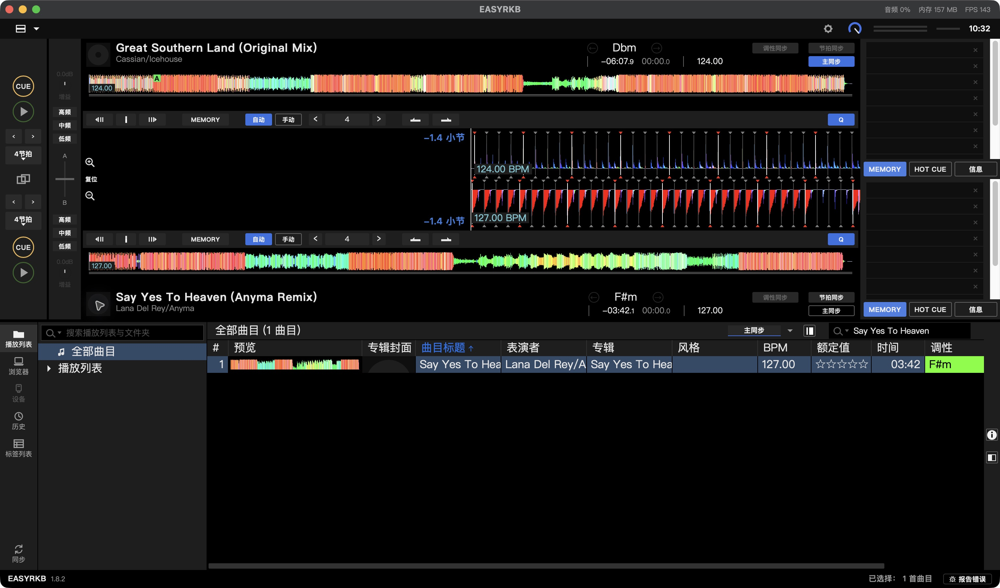
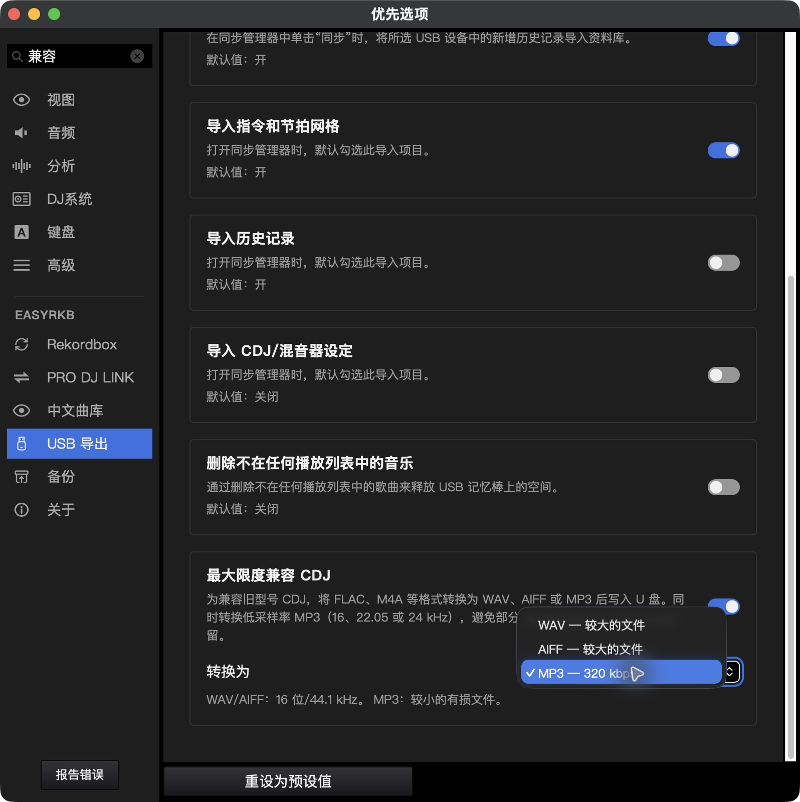
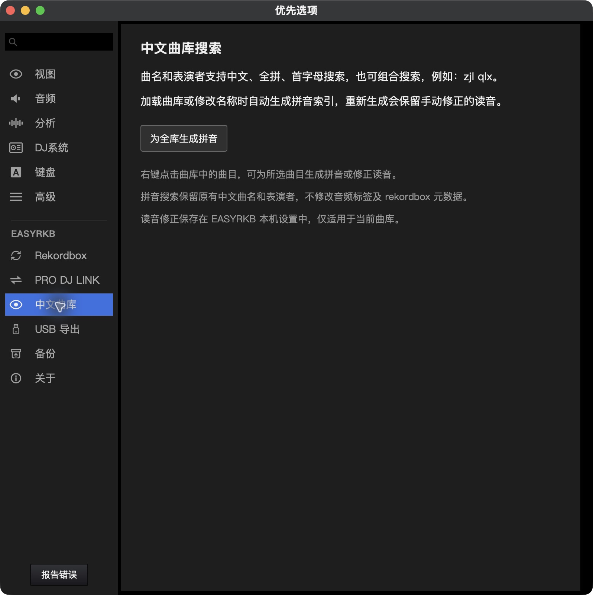

# EASYRKB 界面与功能展示

这些图片直接截取自已发布的原生 macOS Apple Silicon 1.8.2，连接本机真实 rekordbox 数据库。截图时筛选公开发行的歌曲，并收起私人歌单；图片不含个人路径、联系信息或其他私人曲目列表。安装包不附带图中的数据库或音乐。

## 双轨波形与曲库搜索

上下轨各有全曲波形和放大后的拍网视图，公共缩放同时作用于两轨。界面提供 Cue、Memory Cue、节拍循环、跳拍、同步主控和节拍同步；下方曲库支持筛选、排序与曲目预览。

截图中两轨已加载真实音频，均保持暂停。调性同步当前未由音频引擎支持，按钮会显示为不可用。

## USB 导出与老设备兼容

在“设置 → USB 导出”查看兼容选项，可选择 WAV、AIFF 或 320 kbps MP3 副本。WAV／AIFF 使用 16 位、44.1 kHz；电脑上的原文件保留。导出前还可选择保持原格式以及 Device Library、OneLibrary 或双库，具体支持以目标播放器为准。

## 中文曲库与拼音搜索

中文标题和表演者保持原文。全拼、首字母、组合搜索与手动读音修正使用本机离线索引；生成索引不会替换原始中文字段。

## U 盘诊断与修复

入口位于“设置 → USB 导出 → 打开 U 盘诊断与修复”。先选来源盘执行只读诊断，再根据可读数据库预览曲目和歌单。恢复可选备份后重建数据库、写入新空 U 盘或导出恢复 XML。详见 [U 盘修复说明](USB修复.zh-CN.md)。

本次截图没有执行播放、导出、修复或真实 U 盘写入。构建、包校验与硬件验收范围见 [1.8.2 发布说明](https://github.com/PROcrush/EASYRKB/releases/tag/v1.8.2)。

[返回仓库首页](../README.md)
